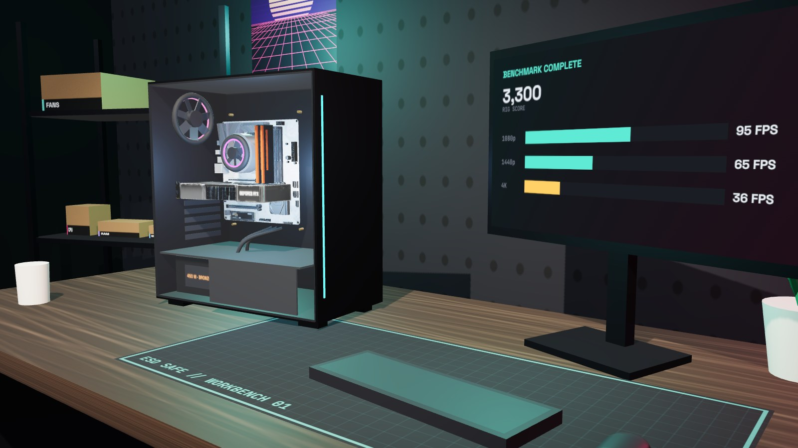
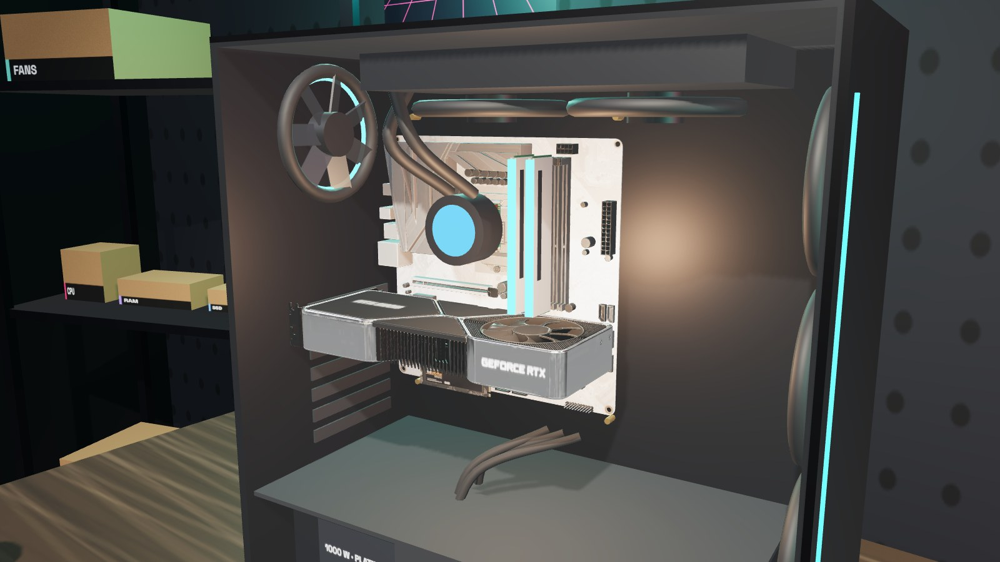

# Rig Builder: 3D PC Building Simulator

Build a PC part by part in a 3D workshop, right in the browser. Pick components from a catalog, watch them install into the case, catch compatibility mistakes before they cost you, then power the machine on and see how it benchmarks.

**[▶ Play it live](https://aaronparayil.github.io/pc_builder_simulator/)**



## What you can do

- **Build in 3D.** Seven steps (motherboard, CPU, cooler, memory, storage, graphics, power supply). Each part flies into its real slot: the CPU into the socket, RAM into the DIMM slots, the GPU into the top PCIe slot.
- **Get caught by real compatibility rules.** Wrong CPU socket, DDR4 sticks in a DDR5 board, a cooler with no bracket for your socket, an under-rated cooler that throttles, a power supply that can't carry the load, or no display output because the CPU has no integrated graphics.
- **Shop on a budget.** Every part has a price and spec chips. The catalog shows whether each option works with what's already installed, and what a swap would cost.
- **Power on.** The PC runs a POST check on the monitor on the desk. If something is wrong it beeps, flags the faulty part and explains how to fix it. If it boots, fans spin up, RGB lights come on and you get frame-rate estimates at 1080p, 1440p and 4K, plus a creator score and a rig score.
- **Take on challenges.** Six briefs, from a $800 1080p gamer to a 4K no-compromise build, each with three stars to earn. Progress is saved in the browser.
- **Walk the showroom.** Every session starts at the showroom entrance: explore on foot with WASD and the mouse, then walk to the glowing workbench and press E to start building. You can leave the bench to explore again at any time. Glass display cases hold every graphics card, processor, memory kit and drive with price plaques; aim at one and press E to browse it or add it to your build.
- **Read the walls.** Seven info posters explain the rules of the game (sockets, DDR4 vs DDR5, power budgets, bottlenecks, cooling, storage speeds and the build order), each readable full-size with E.
- **Compare before you buy.** Side-by-side charts for CPUs (gaming, multi-core, threads, power, price, value) and GPUs (1080p/1440p/4K FPS, VRAM, power, price, value). Pick any part as the baseline and every other bar shows its difference; a table view is one click away.
- **Share a build.** One click copies a link that rebuilds your exact PC for whoever opens it.



## How it's built

| Area | Approach |
| --- | --- |
| Rendering | [three.js](https://threejs.org) with ACES tone mapping, soft shadows and a generated room environment for reflections |
| Scene | The workshop, case, fans, coolers, memory, power supply and drives are built in code from primitives. Posters, desk mat and wood textures are drawn on canvases at runtime |
| Models | CPU, GPU, motherboard and M.2 SSD are glTF models compressed with [glTF Transform](https://gltf-transform.dev) (meshopt geometry + WebP textures), which took them from 94 MB to 2.2 MB |
| Game logic | `src/logic/analyze.js` is a pure, framework-free rules engine: compatibility checks, power draw, and a small performance model (min of CPU-bound and GPU-bound frame rate, with memory and thermal modifiers) |
| Sound | Every sound effect is synthesised with the Web Audio API, so there are no audio files |
| UI | Vanilla JS and CSS, native `<dialog>` modals, keyboard shortcuts, a responsive bottom-sheet layout on phones |
| Quality | `node --test` unit tests, including a brute-force search over the whole catalog proving every challenge can be completed with three stars |
| Delivery | Vite build deployed to GitHub Pages by GitHub Actions on every push to `main` |

The whole site is about 3 MB.

## Run it locally

Requires Node.js 18 or later.

```bash
npm install
npm run dev
```

Then open the URL Vite prints. Other scripts:

```bash
npm test          # rules-engine unit tests
npm run build     # production build in dist/
npm run preview   # serve the production build
```

### Controls

| Input | Action |
| --- | --- |
| Drag / right-drag / scroll | Orbit / pan / zoom the camera |
| Click a part in the case | Select it in the checklist |
| Drag a catalog card onto the 3D view | Install that part |
| `1`–`7` | Jump to a build step |
| `F` | Walk around the showroom (`WASD` move, mouse look, `Shift` run, `E` interact, `Esc` free the mouse) |
| `C` | Compare CPUs and GPUs |
| `P` | Power on / shut down |
| `R` | Reset camera |
| `M` | Mute |

## Project structure

```text
index.html               App shell
src/
  main.js                UI state, rendering and game flow
  styles.css             All styles
  data/catalog.js        Parts, specs and prices
  data/challenges.js     Challenge briefs and star goals
  logic/analyze.js       Compatibility, power and performance rules
  three/engine.js        Renderer, camera, controls and tweening
  three/room.js          The room shell, workbench, monitor, shelves, lights
  three/showroom.js      Display cases, info posters, compare kiosk, decor
  three/walk.js          First-person controller: pointer lock, collisions, aim-to-interact
  three/pcCase.js        Procedural case, fans and slot positions
  three/parts.js         Model loading plus procedural parts
  three/workshop.js      Installs/removes parts, picking, power effects
  three/textures.js      Canvas-generated textures and posters
  ui/compare.js          CPU/GPU comparison charts and table
  ui/                    Monitor screens, sound synth, icons
public/models/           Compressed glTF models
test/                    Unit tests
tools/                   Blender script used to prototype a motherboard model
```

## Credits

3D models used under [CC BY 4.0](https://creativecommons.org/licenses/by/4.0/):

- CPU: [3D PBR Quantum GenX3 Processor](https://sketchfab.com/3d-models/3d-pbr-quantum-genx3-processor-cpu-imaginary-a50bafa2d9914caa9bf185cd16e6935f) by Mustafa Özgen
- GPU: [RTX 3080ti Graphics Card 3d Model](https://sketchfab.com/3d-models/rtx-3080ti-graphics-card-3d-model-7c90da836c4a43ee99afbe0c0f39cf12) by Arham Abdullah
- Motherboard: [motherbard](https://sketchfab.com/3d-models/motherbard-2699be93369c4b15ab8b5f3d4175c81e) by emperorsAmar
- M.2 SSD: [m2ssd_Painter](https://sketchfab.com/3d-models/m2ssd-painter-ccda7c201091445087c02692444641c2) by Igor.Jop

The models were re-compressed and re-oriented for this project. Product names belong to their manufacturers. Prices and performance figures are illustrative estimates, not real benchmark results.

## Background

Rig Builder started as a three.js prototype built during an AR/VR workshop. Version 2 is a ground-up rebuild: a new rules engine and challenge mode, procedural scene and audio, a ~98% smaller download, tests and automated deployment.

Made by [Aaron Parayil](https://github.com/aaronparayil).
